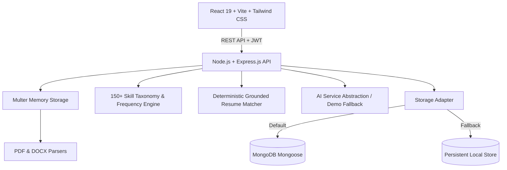

# Job-Ready Decoder 🎯
> **Decode the Job. Identify Your Gaps. Get Interview-Ready.**

[](https://nodejs.org/)
[](https://react.dev/)
[](https://vitejs.dev/)
[](https://tailwindcss.com/)
[](https://www.mongodb.com/)
[](LICENSE)

Job-Ready Decoder is a production-quality web application designed for final-year college students, fresh graduates, and career changers. It cross-analyzes **three real job descriptions** for a target role against your resume, discovers the skills employers repeatedly ask for, classifies your skill gaps into four distinct categories, predicts 8 likely interview questions, and generates a structured, actionable 30-day preparation roadmap.

---

## 📑 Table of Contents
- [Problem & Purpose](#-problem--purpose)
- [Key Features](#-key-features)
- [Architecture & Tech Stack](#-architecture--tech-stack)
- [Directory Structure](#-directory-structure)
- [Prerequisites](#-prerequisites)
- [Environment Variables](#-environment-variables)
- [Quick Start Guide](#-quick-start-guide)
  - [1. Automatic Dependency Install](#1-automatic-dependency-install)
  - [2. Running Backend](#2-running-backend)
  - [3. Running Frontend](#3-running-frontend)
  - [4. Running Concurrently](#4-running-concurrently)
- [Demo / Offline Mode](#-demo--offline-mode)
- [Core Workflows](#-core-workflows)
  - [1. 3-JD Triangulation Engine](#1-3-jd-triangulation-engine)
  - [2. Four-Column Skill Gap Matrix](#2-four-column-skill-gap-matrix)
  - [3. Interview Question Predictor & Top-3 Answer Drills](#3-interview-question-predictor--top-3-answer-drills)
  - [4. 30-Day Preparation Plan](#4-30-day-preparation-plan)
- [REST API Reference](#-rest-api-reference)
- [Security & Quality Standards](#-security--quality-standards)
- [Production Deployment](#-production-deployment)

---

## 💡 Problem & Purpose

- **The Problem with Single-JD Scanning:** Applying or preparing based on a single job posting is misleading because individual job postings contain unique company quirks, legacy technologies, or internal jargon.
- **The Solution:** By requiring **exactly 3 Job Descriptions** for the same target role, Job-Ready Decoder triangulates real industry demand, filtering out noise and isolating skills repeated across at least 2 of 3 postings (`2/3` or `3/3` demand).
- **The Anti-Hallucination Grounding Rule:** Generic ATS checkers tell candidates to invent buzzwords. Job-Ready Decoder strictly verifies tangible proof (projects, internships, metrics) directly in the uploaded resume before classifying a skill as *"Already Have"*.

---

## ✨ Key Features

1. **Multi-Format Document Ingestion:**
   - Upload resumes and job descriptions in **PDF**, **DOCX**, or **TXT** format.
   - Text extraction powered by `pdf-parse` and `mammoth`.
   - Textarea fallback available for direct copy-pasting.

2. **3-JD Skill Frequency Analysis:**
   - 150+ skill taxonomy covering Programming, Frontend, Backend, Database, Cloud, DevOps, Testing, Soft Skills, and Education.
   - Filters out one-off mentions; includes only skills occurring in $\ge 2$ of the 3 JDs.
   - Calculates and displays exact frequency ratios: `2/3` and `3/3`.

3. **Interactive 4-Column Skill Gap Table:**
   - Columns: `| Skill | Frequency | Already Have | Need to Learn | Need to Demonstrate | Not Important for Me |`
   - Instant manual reclassification with radio selectors.
   - Grounded resume evidence snippets with editable candidate rehearsal notes.

4. **8 Predicted Interview Questions:**
   - Spans Technical, Project-based, Resume-based, Behavioral, Problem-solving, and Role-specific questions.
   - Each card details the question, category, why the employer is likely to ask it, and cited resume evidence.

5. **Top 3 Interview Answers & Rehearsal Drills:**
   - Select exactly 3 questions to generate deep STAR-method draft answers.
   - Includes Key Points to hit, Common Mistakes to avoid, and anticipated follow-up questions.
   - Interactive candidate answer editor to rehearse in your own voice.
   - Confidence Rating dropdown: `Low`, `Medium`, `High`.

6. **30-Day Learning Plan Roadmap:**
   - Targets at least 2 identified gaps from `Need to Learn`.
   - 4-week structured milestones + Day 29 Intensive Mock Revision + Day 30 Practical Role Simulation.
   - Interactive task completion checkboxes with real-time progress bar recalculation.

7. **Executive Dashboard & Charts:**
   - Resume Match Score percentage.
   - Skill frequency breakdown bar visualization.
   - 4-column gap distribution donut chart.
   - 30-day preparation readiness gauge.
   - One-click clean print / PDF report export.

8. **Built-in Demo / Offline Mode:**
   - Pre-loaded with complete sample profile ("Alex Morgan", Full Stack Engineer with 3 real FinTech/SaaS JDs).
   - 100% operational without needing an external AI API key or MongoDB setup!

---

## 🛠 Architecture & Tech Stack



- **Frontend:** React 19, Vite, Tailwind CSS, Lucide React icons, Canvas-confetti.
- **Backend:** Node.js, Express.js (ES Modules).
- **Authentication:** JWT (JSON Web Tokens), `bcryptjs` password hashing (10 salt rounds).
- **Database:** MongoDB via Mongoose + automatic local persistent fallback store (`server/data/store.json`).
- **File Parsing:** `pdf-parse`, `mammoth`.
- **Security:** `express-rate-limit`, input sanitization, HTTP-only best practices.

---

## 📁 Directory Structure

```
GEN AI Project/
├── client/                     # Frontend Application (React + Vite + Tailwind)
│   ├── public/
│   ├── src/
│   │   ├── components/
│   │   │   ├── common/         # Navbar, Footer, Badge, ProgressBar, Skeleton, Modal
│   │   │   └── analysis/       # SkillGapTable, InterviewQuestionsList, QuestionAnswerDrill, LearningPlanView, AnalysisCharts
│   │   ├── context/            # AuthContext, ToastContext
│   │   ├── pages/              # LandingPage, AuthPage, CreateAnalysisPage, DashboardPage, AnalysisDetailPage, HistoryPage
│   │   ├── services/           # api.js REST API client
│   │   ├── App.jsx             # Main Router & view orchestration
│   │   ├── index.css           # Tailwind directives & print styling
│   │   └── main.jsx
│   ├── tailwind.config.js
│   └── vite.config.js
├── server/                     # Backend API (Express.js)
│   ├── config/                 # db.js connection & local fallback store
│   ├── controllers/            # authController, uploadController, analysisController
│   ├── middleware/             # authMiddleware, uploadMiddleware, rateLimiter
│   ├── models/                 # User, JobDescription, Resume, Analysis, storage.js
│   ├── routes/                 # authRoutes, uploadRoutes, analysisRoutes
│   ├── services/               # documentParserService, jobAnalysisService, interviewService, learningPlanService, aiProviderService, demoData
│   ├── server.js               # Express application entry point
│   ├── .env                    # Configured backend environment variables
│   └── .env.example
├── package.json                # Root package with monorepo dev scripts
└── README.md
```

---

## ⚙️ Environment Variables

### Backend Configuration (`server/.env`)

```env
PORT=5000
NODE_ENV=development
MONGODB_URI=mongodb://localhost:27017/job_ready_decoder
JWT_SECRET=job_ready_decoder_super_secret_jwt_key_2026_secure
JWT_EXPIRES_IN=7d

# Optional AI Provider (Runs in built-in Demo Mode if left empty)
AI_PROVIDER=gemini
AI_API_KEY=
AI_MODEL=gemini-1.5-flash
```

### Frontend Configuration (`client/.env`) (Optional)

```env
VITE_API_URL=http://localhost:5000/api
```

---

## 🚀 Quick Start Guide

### 1. Automatic Dependency Install
From the workspace root directory:
```bash
npm run install:all
```
*(Installs root, server, and client packages).*

### 2. Running Backend
```bash
npm run server
```
The server will start on `http://localhost:5000`.
- Health check: `http://localhost:5000/api/health`

### 3. Running Frontend
```bash
npm run client
```
The client will start on `http://localhost:5173`.

### 4. Running Concurrently
```bash
npm run dev
```

---

## 🎪 Demo / Offline Mode

Job-Ready Decoder features a built-in **1-Click Demo Mode** that allows recruiters, evaluators, and candidates to test the entire application instantly without requiring an API key or uploading files.

1. Open `http://localhost:5173` in your browser.
2. Click **"Try Demo Job Analysis"** or **"1-Click Demo Sign In"**.
3. You will instantly enter the dashboard loaded with:
   - Sample candidate: *Alex Morgan* (BS in Computer Science).
   - Real resume featuring full-stack projects (*EduAI*, *DevMetrics*) and internship at *TechSprint Labs*.
   - 3 Real Job Descriptions (Fintech, Cloud SaaS, E-Commerce).
   - 12 Recurring Skills (`3/3` and `2/3`).
   - 4-Column Skill Gap classification with grounded evidence.
   - 8 Predicted Interview Questions.
   - 3 Grounded STAR Answers with editable candidate drills.
   - Complete 30-Day Preparation Roadmap with interactive checkboxes.

---

## 🔄 Core Workflows

### 1. 3-JD Triangulation Engine
When the user submits 3 job descriptions:
1. Documents are converted to sanitized text.
2. The 150+ skill taxonomy checks for mentions across JD 1, JD 2, and JD 3.
3. Any skill present in only 1 JD is filtered out as non-essential noise.
4. Skills present in 2 or 3 JDs are ranked and categorized.

### 2. Four-Column Skill Gap Matrix
- **Already Have:** Skill appears on resume with verifiable proof (e.g. `EduAI — React.js frontend implementation`).
- **Need to Demonstrate:** Skill is listed in keywords or coursework, but lacks project metrics.
- **Need to Learn:** Skill appears in multiple JDs but is missing from candidate's background.
- **Not Important for Me:** Skills candidate deliberately opts not to pursue for this role.

### 3. Interview Question Predictor & Top-3 Answer Drills
- The engine generates exactly 8 questions across 6 categories.
- User selects their 3 toughest questions.
- Detailed STAR answers are created referencing candidate projects strictly without hallucinations.
- Candidate edits the answer in their own voice and marks their confidence rating (`Low`, `Medium`, `High`).

### 4. 30-Day Preparation Plan
- Selects the top 2 skill gaps from `Need to Learn` (e.g., Docker & AWS).
- Builds a 4-week milestone plan + Day 29 Intensive Mock + Day 30 Final Assessment.
- Checkboxes trigger persistent updates, recalculating overall preparation progress.

---

## 📡 REST API Reference

### Authentication
| Method | Endpoint | Description |
|---|---|---|
| `POST` | `/api/auth/register` | Register new user account |
| `POST` | `/api/auth/login` | Login with email and password |
| `POST` | `/api/auth/demo` | 1-Click instant demo login |
| `GET` | `/api/auth/me` | Get current authenticated user profile |

### Document Uploads
| Method | Endpoint | Description |
|---|---|---|
| `POST` | `/api/upload/resume` | Upload & extract text from resume (PDF/DOCX) |
| `POST` | `/api/upload/job-description` | Upload & extract text from JD (PDF/DOCX/TXT) |

### Analysis Management
| Method | Endpoint | Description |
|---|---|---|
| `POST` | `/api/analysis` | Run cross-analysis (Resume + 3 JDs) |
| `POST` | `/api/analysis/demo` | Seed and load pre-calculated demo analysis |
| `GET` | `/api/analysis` | List all analyses for current user |
| `GET` | `/api/analysis/:id` | Get analysis details by ID |
| `DELETE` | `/api/analysis/:id` | Delete analysis |
| `PATCH` | `/api/analysis/:id/skills/:skillId` | Update classification or evidence note |
| `POST` | `/api/analysis/:id/interview-questions` | Select top 3 questions & generate answers |
| `PATCH` | `/api/analysis/:id/interview-questions/:questionId` | Update customized answer & confidence rating |
| `PATCH` | `/api/analysis/:id/learning-plan/tasks/:taskId` | Toggle task completion checkbox |

---

## 🔒 Security & Quality Standards

- **Zero Secret Exposure:** API keys and JWT secrets are stored strictly in backend `.env` variables and never sent to the client.
- **Grounded Anti-Hallucination:** Answers and evidence strictly reference candidate source material.
- **File Validation:** Multer restricts uploads to `.pdf`, `.docx`, `.doc`, `.txt` with a 10MB limit.
- **Rate Limiting:** Protects authentication and heavy analysis routes using `express-rate-limit`.
- **Hybrid Storage Reliability:** Seamlessly persists to MongoDB if connected, or to local JSON store if MongoDB is offline.

---

## 📦 Production Deployment

### Building Client for Production
```bash
npm run build
```
This generates the optimized bundle in `client/dist/`.

### Serving with Node.js / Docker
In production, point Express to serve the static frontend bundle from `client/dist/` or deploy `client` to Vercel/Netlify and `server` to Render/Railway/AWS ECS.

---

**Developed with precision for final-year students, fresh graduates, and career changers.**
